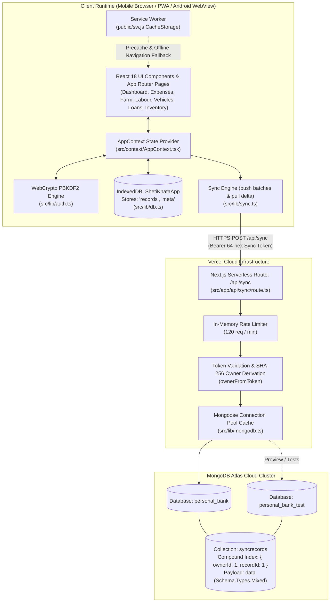
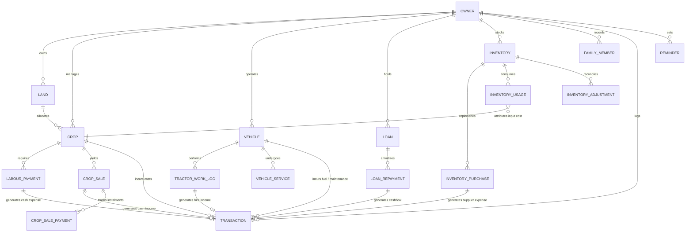
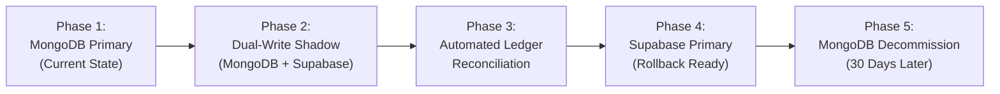
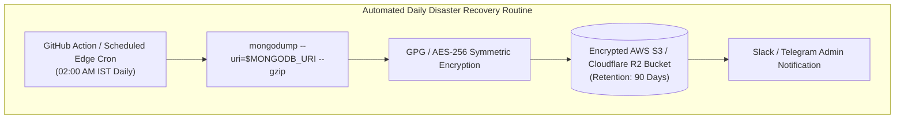

# PERSONAL BANK — COMPLETE DATABASE & ANDROID READINESS TECHNICAL AUDIT

**Target Application:** Personal Bank  
**Production URL:** [https://personalbannk.vercel.app/](https://personalbannk.vercel.app/)  
**GitHub Repository:** [https://github.com/Sumit-tech01/personal-bank.git](https://github.com/Sumit-tech01/personal-bank.git)  
**Local Workspace:** `/Users/apple/Downloads/pappa`  
**Audit Date:** November 5, 2026  
**Auditor:** Senior Software Architect, Financial Systems Auditor, Database & Security Engineer  
**Audit Classification:** READ-ONLY TECHNICAL AUDIT (Zero Production Writes / Zero Schema Changes)

---

## TABLE OF CONTENTS

1. [Executive Summary](#1-executive-summary)
2. [Actual Technology Stack](#2-actual-technology-stack)
3. [System Architecture Diagram](#3-system-architecture-diagram)
4. [MongoDB Collection Inventory & Analysis](#4-mongodb-collection-inventory--analysis)
5. [Database Relationship & Entity Analysis](#5-database-relationship--entity-analysis)
6. [Authentication and Security Findings](#6-authentication-and-security-findings)
7. [Financial Data Integrity Audit](#7-financial-data-integrity-audit)
8. [Offline and Cloud Synchronization Audit](#8-offline-and-cloud-synchronization-audit)
9. [Android Readiness & Native Packaging Evaluation](#9-android-readiness--native-packaging-evaluation)
10. [Proposed Supabase PostgreSQL Architecture](#10-proposed-supabase-postgresql-architecture)
11. [MongoDB Atlas vs. Supabase PostgreSQL Detailed Comparison](#11-mongodb-atlas-vs-supabase-postgresql-detailed-comparison)
12. [Migration Feasibility & Source-to-Destination Mapping](#12-migration-feasibility--source-to-destination-mapping)
13. [Reversible Migration Strategy & Zero Data Loss Protocol](#13-reversible-migration-strategy--zero-data-loss-protocol)
14. [Backup and Disaster Recovery Plan](#14-backup-and-disaster-recovery-plan)
15. [Recommended Architectural Decision](#15-recommended-architectural-decision)
16. [Prioritized Implementation Roadmap](#16-prioritized-implementation-roadmap)
17. [Verification, Testing, and Acceptance Criteria](#17-verification-testing-and-acceptance-criteria)

---

## 1. EXECUTIVE SUMMARY

Personal Bank is an agricultural and household financial management platform designed primarily for Indian farming families. It allows users to track household living expenses, farm inputs (seeds, fertilizers, pesticides), crop lifecycle economics, agricultural labour wages (paid and pending), vehicle and tractor operations (fleet maintenance, fuel, commercial rental hire), loans borrowed and lent, input inventory, and overall family net worth.

### Key Audit Findings

1. **Architecture Model:**  
   The application operates on an **Offline-First, Single-Endpoint Cloud Synchronization Architecture**. The primary client datastore is browser-based **IndexedDB** (`ShetiKhataApp`), managed via the `idb` library. The cloud backend is a serverless Next.js App Router API route (`/api/sync`) connecting to **MongoDB Atlas**.
2. **Database Pattern (MongoDB Atlas):**  
   The cloud database (`personal_bank`) uses a **single generic collection** called `syncrecords`. All 11 distinct domain entities (`transaction`, `crop`, `land`, `labour`, `vehicle`, `reminder`, `loan`, `inventory`, `family`, `category`, `cropsale`) are serialized and stored inside a polymorphic `data: Schema.Types.Mixed` document field. There are no relational tables or multi-collection schemas in MongoDB.
3. **Financial Precision:**  
   The application strictly adheres to **integer paise representation** across the entire codebase. Zero floating-point currency calculations exist for storage or ledger arithmetic. Calculations for crop profitability, tractor operations, loan amortizations, and inventory valuations are mathematically sound and round to integer paise.
4. **Security & Identity:**  
   Authentication is completely passwordless and decentralized. The client creates a local PIN hashed with **WebCrypto PBKDF2 (150,000 iterations, SHA-256, 16-byte random salt)**. Cloud synchronization authenticates via a client-generated **64-character hexadecimal sync token**. The server deterministically hashes this token (`SHA-256`, 40 characters) to derive the `ownerId`. While strict tenant isolation is maintained (users cannot read or modify other owners' records), there is currently **no multi-user family role-based access control (RBAC)**.
5. **Android Readiness:**  
   The application is currently configured as a **Progressive Web App (PWA)** with a valid Web App Manifest (`public/manifest.json`), responsive viewports, and an offline-capable Service Worker (`public/sw.js`). However, Capacitor is **not installed**, and native Android SQLite storage, push notifications, and Google Play Billing are not yet implemented.

### Overall Audit Verdict Matrix

| Audit Domain | Status | Key Takeaway |
| :--- | :---: | :--- |
| **Application Architecture** | **PASS** | Clean Next.js 14 App Router, robust offline separation, zero hardcoded secrets. |
| **MongoDB Atlas Structure** | **WARNING** | Single-collection EAV/Blob pattern. Functional for sync, but lacks database-level constraints. |
| **Authentication & Security** | **WARNING** | Cryptographically strong PIN/token, but in-memory rate limiting and no server-side auth/RBAC. |
| **Financial Integrity** | **PASS** | Integer paise throughout, zero floating-point money math, excellent double-counting defenses. |
| **Offline & Cloud Sync** | **PASS** | Reliable IndexedDB queue, Last-Write-Wins, idempotent upserts; sensitive to client clock skew. |
| **Android Packaging Readiness**| **WARNING** | PWA/TWA ready immediately; Capacitor / Native APK requires wrapper setup and local storage hardening. |
| **Supabase Feasibility** | **PASS** | Highly feasible; PostgreSQL schema perfectly maps all entities with strict foreign keys and RLS. |

---

## 2. ACTUAL TECHNOLOGY STACK

All findings below were verified directly from `/Users/apple/Downloads/pappa/package.json`, source files in `src/`, and deployment scripts in `scripts/`.

| Layer | Component | Version / Specification | Source Verification |
| :--- | :--- | :--- | :--- |
| **Frontend Framework** | Next.js (App Router) | `14.2.35` | [package.json](file:///Users/apple/Downloads/pappa/package.json#L16) |
| **UI Library** | React & React DOM | `^18.0.0` | [package.json](file:///Users/apple/Downloads/pappa/package.json#L17-L18) |
| **Language** | TypeScript | `^5.0.0` (Strict mode) | [tsconfig.json](file:///Users/apple/Downloads/pappa/tsconfig.json) |
| **Styling** | Tailwind CSS | `^3.4.1` | [tailwind.config.ts](file:///Users/apple/Downloads/pappa/tailwind.config.ts) |
| **Icons** | Lucide React | `^1.66.0` | [package.json](file:///Users/apple/Downloads/pappa/package.json#L14) |
| **Typography** | Geist Font Family | Local WOFF (`GeistVF`, `GeistMonoVF`) | [src/app/layout.tsx](file:///Users/apple/Downloads/pappa/src/app/layout.tsx#L7-L12) |
| **Local Client Storage**| IndexedDB | `idb` (`^8.0.4`) Database: `ShetiKhataApp` v1 | [src/lib/db.ts](file:///Users/apple/Downloads/pappa/src/lib/db.ts#L1-L26) |
| **Cloud ODM / Client** | Mongoose | `^9.11.4` | [package.json](file:///Users/apple/Downloads/pappa/package.json#L15) |
| **Cloud Database** | MongoDB Atlas | Cluster host: `personal-bank.0ov7umc.mongodb.net`<br>Databases: `personal_bank` (Prod), `personal_bank_test` (Test) | [src/lib/mongodb.ts](file:///Users/apple/Downloads/pappa/src/lib/mongodb.ts#L62-L63) |
| **Cloud Hosting** | Vercel Serverless | Node.js runtime (`nodejs`), dynamic route execution | [src/app/api/sync/route.ts](file:///Users/apple/Downloads/pappa/src/app/api/sync/route.ts#L10-L11) |
| **PWA & Offline** | Service Worker & Manifest | `CacheStorage` (`personal-bank-v1`), `manifest.json` | [public/sw.js](file:///Users/apple/Downloads/pappa/public/sw.js#L1-L10), [public/manifest.json](file:///Users/apple/Downloads/pappa/public/manifest.json) |
| **Internationalization**| Bilingual (English / Marathi) | Client-side dictionary engine (`en`, `mr`) | [src/lib/i18n/index.ts](file:///Users/apple/Downloads/pappa/src/lib/i18n/index.ts) |

---

## 3. SYSTEM ARCHITECTURE DIAGRAM



---

## 4. MONGODB COLLECTION INVENTORY & ANALYSIS

### 4.1 Collection Inventory

In MongoDB Atlas, the database contains **exactly one active application collection**:

- **Database Name:** `personal_bank` (Production) / `personal_bank_test` (Preview / CI)
- **Collection Name:** `syncrecords`
- **Total Registered Collections in Production:** `1`

Verified in:
- Model definition: [`src/models/index.ts`](file:///Users/apple/Downloads/pappa/src/models/index.ts#L19-L40)
- API endpoint: [`src/app/api/sync/route.ts`](file:///Users/apple/Downloads/pappa/src/app/api/sync/route.ts#L114-L125)
- Automated diagnostics: [`scripts/inspect-database-architecture.ts`](file:///Users/apple/Downloads/pappa/scripts/inspect-database-architecture.ts#L86-L96)

### 4.2 Document Structure in `syncrecords`

```typescript
{
  _id: ObjectId("..."),
  ownerId: "d6f83ab...",               // String (40 chars): SHA-256 hex digest of private sync token
  recordId: "transaction_722c5328...", // String: Client-generated UUID or prefixed unique record ID
  entity: "transaction",               // String: One of 11 allowed entity types
  updatedAt: "2026-11-03T18:25:50.000Z",// String: ISO 8601 UTC timestamp of client record edit
  data: {                              // Mixed (JSON Object): Complete serialized entity payload
    id: "transaction_722c5328...",
    entity: "transaction",
    ownerId: "d6f83ab...",
    kind: "EXPENSE",
    amountPaise: 3000000,              // ₹30,000 in integer paise
    category: "Seeds",
    group: "FARM",
    date: "2026-11-03",
    description: "Cotton Seed Purchase",
    paymentMethod: "CASH",
    createdAt: "2026-11-03T18:25:50.000Z",
    updatedAt: "2026-11-03T18:25:50.000Z",
    deletedAt: null                    // Null if active; ISO string if soft-deleted
  },
  createdAt: ISODate("2026-11-03T18:25:50.120Z"), // Mongoose auto-timestamp (Date)
  lastSeenAt: ISODate("2026-11-03T18:25:50.120Z") // Date of last sync operation
}
```

### 4.3 Database Indexes and Constraints

Verified from [`src/models/index.ts#L31-L36`](file:///Users/apple/Downloads/pappa/src/models/index.ts#L31-L36) and live inspection in [`scripts/inspect-database-architecture.ts`](file:///Users/apple/Downloads/pappa/scripts/inspect-database-architecture.ts#L255-L287):

| Index Specification | Index Type | Unique | Purpose / Audit Assessment |
| :--- | :--- | :---: | :--- |
| `{ _id: 1 }` | Default B-Tree | Yes | MongoDB default internal identifier. |
| `{ ownerId: 1, recordId: 1 }` | Compound B-Tree | **Yes** | **Primary deduplication defense.** Guarantees that no single owner can have duplicate documents for the same client entity ID. |
| `{ ownerId: 1, updatedAt: 1 }` | Compound B-Tree | No | Powers pull synchronization (`updatedAt > since`). Ensures fast, indexed delta queries. |
| `{ ownerId: 1, entity: 1 }` | Compound B-Tree | No | Facilitates entity-filtered recovery queries. |
| `{ ownerId: 1, entity: 1, updatedAt: 1 }` | Compound B-Tree | No | Covered index for delta pulls by specific entity type. |
| `{ ownerId: 1, "data.deletedAt": 1 }` | Compound Sparse | No | Fast filtering of active vs soft-deleted records. |
| `{ lastSeenAt: 1 }` | Single-field B-Tree | No | Maintenance index for identifying inactive accounts. |

### 4.4 In-Depth Analysis of `syncrecords`

1. **Owner Identity Derivation:**  
   The `ownerId` is computed on the server in [`src/app/api/sync/route.ts#L53-L55`](file:///Users/apple/Downloads/pappa/src/app/api/sync/route.ts#L53-L55) via `createHash("sha256").update(token).digest("hex").slice(0, 40)`. The private sync token itself is never stored in the database.
2. **Financial Data Content:**  
   The entire financial ledger (transaction amounts, loan principals, crop sales revenue, labour payments) is embedded in plaintext inside `data`.
3. **Update Semantics (Overwrite vs Merge):**  
   Updates execute via `findOneAndUpdate` using `$set: { entity, updatedAt, data, lastSeenAt }` ([`src/app/api/sync/route.ts#L252-L263`](file:///Users/apple/Downloads/pappa/src/app/api/sync/route.ts#L252-L263)). **This is a complete overwrite of the `data` subdocument.** It does *not* perform deep field-level merging.
4. **Duplicate Prevention:**  
   The compound unique index `{ ownerId: 1, recordId: 1 }` strictly rejects duplicate inserts with error code `E11000`. Upserts cleanly update the existing record.
5. **Database Lifecycle & Connection Caching:**  
   [`src/lib/mongodb.ts#L14-L226`](file:///Users/apple/Downloads/pappa/src/lib/mongodb.ts#L14-L226) caches the Mongoose connection promise in `global.mongooseCache`. It validates connection status (`readyState === 1`) and recycles connections across serverless lambda invocations. Connection options specify `serverSelectionTimeoutMS: 15000`, `connectTimeoutMS: 15000`, `socketTimeoutMS: 45000`, and `maxPoolSize: 10`.

---

## 5. DATABASE RELATIONSHIP & ENTITY ANALYSIS

Because MongoDB Atlas stores all entities in a single collection as generic blobs, all relational constraints are currently enforced **client-side in TypeScript within `AppContext.tsx`**.



### Entity Inventory and Relationship Specifications

| Entity | Primary Identifiers | Foreign Key References | Storage Location | Referential Integrity Assessment |
| :--- | :--- | :--- | :--- | :--- |
| **Transaction** | `id` (`tx-...`) | `cropId`, `landId`, `vehicleId`, `labourPaymentId`, `inventoryPurchaseId` | Top-level in `records` / `syncrecords` | **WARNING:** If a referenced `Crop` or `Vehicle` is deleted, `Transaction` retains the dead string reference. Handled gracefully by `runFinancialReconciliation`. |
| **Crop** | `id` (`crop-...`) | `landId` | Top-level in `records` / `syncrecords` | **PASS:** Soft-deletes cleanly. Historic seasons preserved. |
| **Land** | `id` (`land-...`) | None | Top-level in `records` / `syncrecords` | **PASS:** Root spatial entity. |
| **LabourPayment** | `id` (`labour-...`) | `cropId`, `landId`, `transactionId` | Top-level in `records` / `syncrecords` | **PASS:** Direct link to `Transaction`. Soft-deleting labour cascades to soft-delete the linked cash transaction. |
| **CropSale** | `id` (`cropsale-...`) | `cropId`, `landId`, `transactionId` | Top-level in `records` / `syncrecords` | **PASS:** Multi-instalment payments embedded in `payments[]`. Linked transaction tagged with `[cropsale:id]`. |
| **Vehicle** | `id` (`veh-...`) | `loanId` | Top-level in `records` / `syncrecords` | **WARNING:** Contains embedded arrays `tractor.logs[]` and `serviceHistory[]`. As logs grow, document size increases. |
| **Loan** | `id` (`loan-...`) | `vehicleId`, `reminderId` | Top-level in `records` / `syncrecords` | **WARNING:** Repayments embedded in `repayments[]`. Large repayment histories increase document size. Cash transaction link is optional. |
| **InventoryItem** | `id` (`inv-...`) | None | Top-level in `records` / `syncrecords` | **WARNING:** Contains embedded arrays `purchases[]`, `usageHistory[]`, `adjustments[]`. High-volume farms will hit document bloat. |
| **FamilyMember** | `id` (`fam-...`) | None | Top-level in `records` / `syncrecords` | **PASS:** Simple contact record. |
| **Reminder** | `id` (`rem-...`) | `linkedId`, `linkedType` | Top-level in `records` / `syncrecords` | **PASS:** Polymorphic link to crops, vehicles, loans, inventory. |
| **CustomCategory**| `id` (`cat-...`) | None | Top-level in `records` / `syncrecords` | **PASS:** User-defined category tag. |

---

## 6. AUTHENTICATION AND SECURITY FINDINGS

### 6.1 Authentication Mechanism Audit

Personal Bank utilizes a client-centric authentication model tailored for rural financial privacy:

1. **Local Authentication:**
   - Handled in [`src/lib/auth.ts`](file:///Users/apple/Downloads/pappa/src/lib/auth.ts#L54-L74) using standard Web Cryptography API (`crypto.subtle`).
   - PINs (4 to 6 digits) are hashed with **PBKDF2-HMAC-SHA256** using **150,000 iterations** and a **128-bit random cryptographic salt**.
   - Timing attacks are prevented by a constant-time comparison helper `safeEqual` ([`src/lib/auth.ts#L99-L106`](file:///Users/apple/Downloads/pappa/src/lib/auth.ts#L99-L106)).
   - Session duration is controlled by `sessionStorage` with a 12-hour TTL (`SESSION_TTL_MS = 43,200,000`).
2. **Cloud API Authentication:**
   - The cloud endpoint requires an HTTP header: `Authorization: Bearer <64-character hex string>`.
   - The token represents 256 bits of cryptographic entropy (`randomBytes(32)`).
   - Validated by regular expression `/^[a-f0-9]{64}$/i` ([`src/app/api/sync/route.ts#L57-L59`](file:///Users/apple/Downloads/pappa/src/app/api/sync/route.ts#L57-L59)).

### 6.2 Security Vulnerabilities & Findings Matrix

| Finding ID | Finding Description | Severity | Source File & Location | Details & Recommendation |
| :--- | :--- | :---: | :--- | :--- |
| **SEC-01** | Cross-Tenant Isolation | **PASS** | [`src/app/api/sync/route.ts#L113-L125`](file:///Users/apple/Downloads/pappa/src/app/api/sync/route.ts#L113-L125), [`#L243-L263`](file:///Users/apple/Downloads/pappa/src/app/api/sync/route.ts#L243-L263) | **A user cannot access another user's records.** Every MongoDB query strictly enforces `{ ownerId }` where `ownerId = sha256(token).slice(0, 40)`. |
| **SEC-02** | Serverless In-Memory Rate Limiting | **CRITICAL** | [`src/app/api/sync/route.ts#L31-L51`](file:///Users/apple/Downloads/pappa/src/app/api/sync/route.ts#L31-L51) | The rate limiter uses an in-memory `Map<string, RateLimitEntry>`. In Vercel serverless functions, state is destroyed between lambda cold starts and not shared across instances. An attacker can bypass the 120 req/min limit by hitting different lambda instances. **Recommendation:** Migrate rate limiting to Upstash Redis or Supabase edge functions. |
| **SEC-03** | Lack of Server-Side RBAC | **WARNING** | [`src/models/index.ts`](file:///Users/apple/Downloads/pappa/src/models/index.ts) | There are no user roles (e.g., Family Head, Accountant, Viewer). Anyone in possession of the 64-hex token possesses absolute read/write/delete privileges for the entire financial diary. |
| **SEC-04** | Client PIN Lockout Bypass | **WARNING** | [`src/context/AppContext.tsx#L164-L176`](file:///Users/apple/Downloads/pappa/src/context/AppContext.tsx#L164-L176) | PIN retry throttling state (`sheti_khata_attempts_${ownerId}`) is stored in browser `localStorage`. A malicious actor with physical access can clear `localStorage` to reset the lockout counter. |
| **SEC-05** | Plaintext Token in IndexedDB | **WARNING** | [`src/lib/db.ts#L70-L76`](file:///Users/apple/Downloads/pappa/src/lib/db.ts#L70-L76) | The 64-hex sync token is stored unencrypted inside IndexedDB store `meta` under key `account`. If an XSS vulnerability occurs or the device is compromised, the token can be exfiltrated. |
| **SEC-06** | Secret Credentials Management | **PASS** | [`.gitignore#L42-L48`](file:///Users/apple/Downloads/pappa/scripts/test-vercel-readiness.ts#L42-L48), [`.env.example`](file:///Users/apple/Downloads/pappa/.env.example) | Zero hardcoded connection strings or passwords in git. `.gitignore` strictly excludes `.env*`, `.pem`, `.key`, and backups. |

---

## 7. FINANCIAL DATA INTEGRITY AUDIT

### 7.1 Integer Paise Representation Verification

A critical financial auditing requirement is the absolute prevention of floating-point IEEE-754 binary arithmetic errors (e.g., `0.1 + 0.2 = 0.30000000000000004`).

- **Verification Status:** **PASS**
- **Evidence:**  
  [`src/lib/money.ts#L7-L23`](file:///Users/apple/Downloads/pappa/src/lib/money.ts#L7-L23):
  ```typescript
  export function parseAmountToPaise(input: string): number | null {
    // Splits input by '.' and scales rupees * 100 + paise
    const [rupeesPart, paisePart = ""] = cleaned.split(".");
    const rupees = Number(rupeesPart);
    const paise = Number((paisePart + "00").slice(0, 2));
    const total = rupees * 100 + paise;
    if (!Number.isSafeInteger(total) || total < 0 || total > MAX_AMOUNT_PAISE) return null;
    return total;
  }
  ```
  Every financial ledger field across all models uses `*Paise` (`amountPaise`, `principalPaise`, `ratePaise`, `emiPaise`, `totalCostPaise`, `receivedPaise`, `pendingPaise`). Display formatting to Rupees occurs strictly at render time via `Intl.NumberFormat('en-IN')`.

### 7.2 Double-Counting Prevention Audit

Agricultural and small business ledgers frequently suffer from double counting when cross-entity transactions occur. We inspected all cross-entity pathways:

1. **Labour Wages vs. Cash Expenses:**
   - **Mechanism:** When a labour record is paid (`paidPaise > 0`), [`src/context/AppContext.tsx#L1914-L1949`](file:///Users/apple/Downloads/pappa/src/context/AppContext.tsx#L1914-L1949) automatically creates a linked `Transaction` (`group: "FARM"`, `category: "Labour"`, `labourPaymentId: labourId`).
   - **Prevention in Dashboard:** [`src/lib/finance.ts#L89-L93`](file:///Users/apple/Downloads/pappa/src/lib/finance.ts#L89-L93) calculates totals by summing only `transactions.filter(isExpense)`. The raw `LabourPayment` entity is *never* added directly to total cash outflow, preventing double counting.
   - **Prevention in Crop Profit:** [`src/lib/finance.ts#L485-L491`](file:///Users/apple/Downloads/pappa/src/lib/finance.ts#L485-L491) explicitly filters out any transaction having `row.labourPaymentId` before adding manual farm expenses, ensuring labour is counted exactly once from the labour ledger.
   - **Verdict:** **PASS**
2. **Crop Sales Revenue vs. Cash Inflow:**
   - **Mechanism:** Recording a crop sale creates a linked `Transaction` with notes containing `[cropsale:${cropSaleId}]`.
   - **Prevention:** [`src/lib/finance.ts#L578-L580`](file:///Users/apple/Downloads/pappa/src/lib/finance.ts#L578-L580) explicitly filters out any transaction matching `[cropsale:` when aggregating crop revenues, sourcing revenue exclusively from the `CropSale` ledger.
   - **Verdict:** **PASS**
3. **Loan Repayments vs. Cash Outflow:**
   - **Mechanism:** [`src/context/AppContext.tsx#L2668-L2693`](file:///Users/apple/Downloads/pappa/src/context/AppContext.tsx#L2668-L2693) exposes an explicit flag `recordCashTransaction`. Only when this toggle is true does a corresponding cash `Transaction` get recorded.
   - **Verdict:** **PASS**
4. **Opening Balance Treatment:**
   - **Mechanism:** Opening cash balances must increase available cash without artificially inflating earned period income.
   - **Verification:** [`src/lib/finance.ts#L43-L51`](file:///Users/apple/Downloads/pappa/src/lib/finance.ts#L43-L51) strictly filters out opening balances (`!isOpeningBalance(t)`) from received income. In [`src/lib/finance.ts#L113-L124`](file:///Users/apple/Downloads/pappa/src/lib/finance.ts#L113-L124), opening balance is added directly to `availableBalance`.
   - **Verdict:** **PASS**

### 7.3 Financial Integrity Vulnerabilities & Warnings

| Finding ID | Area | Severity | Source Location | Description |
| :--- | :--- | :---: | :--- | :--- |
| **FIN-01** | Inventory Usage vs Direct Expense | **WARNING** | [`src/lib/finance.ts#L524-L552`](file:///Users/apple/Downloads/pappa/src/lib/finance.ts#L524-L552) | If a farmer enters a direct cash expense for "Fertilizers" linked to Crop A, and *also* logs an Inventory Usage of fertilizer from stock for Crop A, both costs are summed into `totalInvestmentPaise`. Users must be trained to either log direct expenses OR inventory consumption, not both for the same physical bag. |
| **FIN-02** | Orphan References on Deletion | **WARNING** | [`src/context/AppContext.tsx#L1513-L1519`](file:///Users/apple/Downloads/pappa/src/context/AppContext.tsx#L1513-L1519), [`#L2192-L2198`](file:///Users/apple/Downloads/pappa/src/context/AppContext.tsx#L2192-L2198) | Deleting a Crop or Vehicle soft-deletes the parent entity, but does not cascade to historical transactions. While historical financial cashflow is preserved, `transaction.cropId` references a deleted ID. Caught by the reconciliation engine ([`src/lib/finance.ts#L2300-L2326`](file:///Users/apple/Downloads/pappa/src/lib/finance.ts#L2300-L2326)). |
| **FIN-03** | Accrual vs Cash Timing | **PASS** | [`src/lib/finance.ts#L592-L594`](file:///Users/apple/Downloads/pappa/src/lib/finance.ts#L592-L594) | Both `profitPaise` (accrual basis including pending sales and unpaid labour) and `cashProfitPaise` (strictly cash in hand minus cash paid) are computed side-by-side. |

---

## 8. OFFLINE AND CLOUD SYNCHRONIZATION AUDIT

### 8.1 Offline Architecture & Local Queue

- **Local Datastore:** IndexedDB database `ShetiKhataApp` v1 with object store `records` (keyPath `id`) and `meta` (keyPath `key`) ([`src/lib/db.ts#L21-L46`](file:///Users/apple/Downloads/pappa/src/lib/db.ts#L21-L46)).
- **Dirty Tracking:** Every write operation sets `dirty: true` and stamps `updatedAt = nowISO()`.
- **Offline Functionality:** 100% of user operations (record creation, edits, reports, backup export, language toggle) operate without any internet connectivity.

### 8.2 Synchronization Mechanics

The synchronization lifecycle implemented in [`src/context/AppContext.tsx#L824-L965`](file:///Users/apple/Downloads/pappa/src/context/AppContext.tsx#L824-L965) executes in two phases:

1. **Push Phase (Upload):**
   - Retrieves pending records: `dirty = await getDirtyRecords(currentAccount.id)`.
   - Batches records into chunks of 20 ([`#L861`](file:///Users/apple/Downloads/pappa/src/context/AppContext.tsx#L861)).
   - Sends payload to `/api/sync` with `since: "9999-12-31T23:59:59.999Z"` (prevents pulling during push).
   - Upon server acknowledgement, client executes `markRecordsSynced`, flipping `dirty: false` for records matching `updatedAt`.
2. **Pull Phase (Download):**
   - Retrieves delta: `pull = await syncWithCloud({ token, since: meta.lastSyncAt, changes: [] })`.
   - Merges remote records into IndexedDB if `incoming.updatedAt > local.updatedAt`.
   - Updates `meta.lastSyncAt = serverTime`.
3. **Triggering Lifecycle:**
   - On mutation: Debounced by 1,500ms (`scheduleSyncRef`).
   - On reconnect: Triggered by `window.online`.
   - On visibility: Triggered when app tab or window gains focus (`document.visibilitychange`).
   - Periodic: Polled every 60 seconds (`setInterval`).
   - Failure Backoff: Exponential backoff doubling from 2s to 60s (`retryBackoffMs`).

### 8.3 Synchronization Findings & Vulnerabilities

| Finding ID | Area | Severity | Source Location | Finding & Risk Assessment |
| :--- | :--- | :---: | :--- | :--- |
| **SYNC-01** | Client Clock Skew Vulnerability | **CRITICAL** | [`src/app/api/sync/route.ts#L247-L250`](file:///Users/apple/Downloads/pappa/src/app/api/sync/route.ts#L247-L250) | The server conflict resolution strictly compares ISO timestamp strings: `if (existing && existing.updatedAt > change.updatedAt) rejected.push(...)`. If Client A's device clock is erroneously set to a future year (e.g. 2027), all records stamped by Client A will permanently block any future edits by Client B (whose clock is 2026). **Recommendation:** Server must enforce server-assigned monotonic sequence numbers or hybrid logical clocks (HLC). |
| **SYNC-02** | Full Overwrite on Conflict | **WARNING** | [`src/app/api/sync/route.ts#L252-L262`](file:///Users/apple/Downloads/pappa/src/app/api/sync/route.ts#L252-L262) | Conflicts are resolved by Last-Write-Wins (LWW) at the entire document level. If User 1 edits a vehicle's odometer and User 2 logs a fuel fill-up on another device offline, the last synced document completely overwrites the other, resulting in data loss of the overwritten fields. |
| **SYNC-03** | Multi-Device Token Sharing UX | **WARNING** | [`src/components/auth/AuthScreens.tsx`](file:///Users/apple/Downloads/pappa/src/components/auth/AuthScreens.tsx) | There is no UI screen or QR code scanner to display or share the private sync token between family phones. A user must export a JSON backup on Device 1 and import it on Device 2 to clone the account and sync token. |
| **SYNC-04** | IndexedDB Storage Eviction | **WARNING** | [`src/lib/db.ts`](file:///Users/apple/Downloads/pappa/src/lib/db.ts) | Under Android OS storage pressure, the browser or WebView can silently evict IndexedDB data if `navigator.storage.persist()` is not granted. Currently, `persist()` is not requested. |

---

## 9. ANDROID READINESS & NATIVE PACKAGING EVALUATION

### 9.1 PWA / WebAPK Status

- **Web App Manifest:** Present at [`public/manifest.json`](file:///Users/apple/Downloads/pappa/public/manifest.json). Configured with `display: "standalone"`, `theme_color: "#2F7D4F"`, `background_color: "#F5F7F3"`, orientation `portrait`.
- **Icon Packaging:** Verified all required icon sizes exist in `public/`:
  - `icon-192.png` (192x192 PNG)
  - `icon-512.png` (512x512 PNG, maskable)
  - `icon.svg` (Scalable vector)
  - `apple-touch-icon.png` (180x180 PNG)
- **Service Worker:** Present at [`public/sw.js`](file:///Users/apple/Downloads/pappa/public/sw.js). Caches shell assets and provides offline navigation fallback while explicitly bypassing `/api/sync`.
- **Verdict:** **PASS.** The web application is 100% installable today on Android via Chrome WebAPK.

### 9.2 Native Packaging Analysis (Capacitor vs TWA vs Native)

| Dimension | Option A: Trusted Web Activity (TWA / Bubblewrap) | Option B: Capacitor Wrapper (Hybrid) | Option C: 100% Native Kotlin / Jetpack Compose |
| :--- | :--- | :--- | :--- |
| **Backend Code Changes** | **Zero changes required.** Points to existing production Next.js deployment. | **Requires architectural split.** Next.js must be configured for static export or load remote URL. | **Requires complete rewrite** of client layer in Kotlin/Android SDK. |
| **Offline Capability** | Leverages existing Service Worker & IndexedDB. | Bundles static HTML/JS inside APK. Uses IndexedDB or native SQLite plugin. | Built-in Room / SQLite offline database. |
| **Storage Durability** | Moderate (Chromium WebView LevelDB). | High (if using `@capacitor-community/sqlite`). | Maximum (Android Room Database with SQLCipher). |
| **Hardware Back Button** | Handled by browser history stack. | Requires `App.addListener('backButton')` to close modal sheets. | Native Android `OnBackPressedDispatcher`. |
| **Push Notifications** | Web Push API (FCM via Service Worker). | Native FCM via `@capacitor/push-notifications`. | Native Firebase Cloud Messaging SDK. |
| **Google Play Billing** | Requires Google Play Digital Goods API. | `@capacitor-community/google-pay` or RevenueCat plugin. | Google Play Billing Library v6. |
| **AdMob Support** | Restricted in TWA (banner overlays difficult). | `@capacitor-community/admob` native overlays. | Google Mobile Ads SDK for Android. |
| **Effort to Google Play**| **1 - 2 Days** (Automated via Google Bubblewrap CLI). | **1 - 2 Weeks** (Capacitor project setup & asset bundling). | **8 - 12 Weeks** (Full rewrite). |

### 9.3 Android Packaging Verdict

- **Immediate Deployment Recommendation:** Package the verified production web application as a **Trusted Web Activity (TWA)** using Google's official Bubblewrap CLI. This produces a production Android `.aab` / `.apk` ready for the Google Play Console without touching a single line of backend code.
- **Future Long-Term Architecture:** If native encrypted SQLite storage (SQLCipher), native AdMob banners, or Google Play Billing in-app subscriptions are required, migrate to a **Capacitor Hybrid Container**.

---

## 10. PROPOSED SUPABASE POSTGRESQL ARCHITECTURE

To eliminate the limitations of MongoDB's generic document store (untyped blobs, zero foreign keys, full-document overwrites, in-memory rate limiting), we designed a relational PostgreSQL schema tailored to Personal Bank's exact domain models.

### 10.1 Complete PostgreSQL Relational Schema

```sql
-- ==============================================================================
-- PERSONAL BANK — PRODUCTION SUPABASE POSTGRESQL RELATIONAL SCHEMA
-- ==============================================================================

CREATE EXTENSION IF NOT EXISTS "uuid-ossp";

-- 1. PROFILES (Extends Supabase auth.users)
CREATE TABLE public.profiles (
    id UUID PRIMARY KEY REFERENCES auth.users(id) ON DELETE CASCADE,
    full_name TEXT NOT NULL,
    phone TEXT,
    location TEXT,
    preferred_language VARCHAR(5) DEFAULT 'en' CHECK (preferred_language IN ('en', 'mr')),
    avatar_url TEXT,
    created_at TIMESTAMPTZ DEFAULT TIMEZONE('utc', NOW()) NOT NULL,
    updated_at TIMESTAMPTZ DEFAULT TIMEZONE('utc', NOW()) NOT NULL
);

-- 2. FAMILIES (Multi-tenant family accounts)
CREATE TABLE public.families (
    id UUID PRIMARY KEY DEFAULT gen_random_uuid(),
    name TEXT NOT NULL,
    created_by UUID REFERENCES public.profiles(id) ON DELETE RESTRICT NOT NULL,
    created_at TIMESTAMPTZ DEFAULT TIMEZONE('utc', NOW()) NOT NULL,
    updated_at TIMESTAMPTZ DEFAULT TIMEZONE('utc', NOW()) NOT NULL
);

-- 3. FAMILY_MEMBERS (Family RBAC and Authorization)
CREATE TABLE public.family_members (
    id UUID PRIMARY KEY DEFAULT gen_random_uuid(),
    family_id UUID REFERENCES public.families(id) ON DELETE CASCADE NOT NULL,
    user_id UUID REFERENCES public.profiles(id) ON DELETE SET NULL,
    name TEXT NOT NULL,
    relation TEXT NOT NULL,
    date_of_birth DATE,
    phone TEXT,
    role VARCHAR(20) DEFAULT 'editor' CHECK (role IN ('owner', 'admin', 'editor', 'viewer')) NOT NULL,
    notes TEXT,
    created_at TIMESTAMPTZ DEFAULT TIMEZONE('utc', NOW()) NOT NULL,
    updated_at TIMESTAMPTZ DEFAULT TIMEZONE('utc', NOW()) NOT NULL,
    legacy_id TEXT
);

-- 4. ACCOUNTS (Cash in Hand, Bank Accounts, Wallets)
CREATE TABLE public.accounts (
    id UUID PRIMARY KEY DEFAULT gen_random_uuid(),
    family_id UUID REFERENCES public.families(id) ON DELETE CASCADE NOT NULL,
    name TEXT NOT NULL,
    type VARCHAR(20) CHECK (type IN ('CASH', 'BANK', 'UPI', 'SAVINGS', 'WALLET')) NOT NULL,
    account_number TEXT,
    bank_name TEXT,
    opening_balance_paise BIGINT DEFAULT 0 NOT NULL,
    current_balance_paise BIGINT DEFAULT 0 NOT NULL,
    is_default BOOLEAN DEFAULT FALSE NOT NULL,
    created_at TIMESTAMPTZ DEFAULT TIMEZONE('utc', NOW()) NOT NULL,
    updated_at TIMESTAMPTZ DEFAULT TIMEZONE('utc', NOW()) NOT NULL
);

-- 5. LANDS (Agricultural plots & parcels)
CREATE TABLE public.lands (
    id UUID PRIMARY KEY DEFAULT gen_random_uuid(),
    family_id UUID REFERENCES public.families(id) ON DELETE CASCADE NOT NULL,
    name TEXT NOT NULL,
    survey_number TEXT,
    total_area NUMERIC(10,2),
    area_unit VARCHAR(20) CHECK (area_unit IN ('Acre', 'Hectare', 'Guntha')),
    area_acres NUMERIC(10,4) NOT NULL CHECK (area_acres >= 0),
    location TEXT,
    soil_type TEXT,
    irrigation TEXT,
    notes TEXT,
    created_at TIMESTAMPTZ DEFAULT TIMEZONE('utc', NOW()) NOT NULL,
    updated_at TIMESTAMPTZ DEFAULT TIMEZONE('utc', NOW()) NOT NULL,
    deleted_at TIMESTAMPTZ,
    legacy_id TEXT
);

-- 6. CROPS (Crop lifecycle and seasonal planning)
CREATE TABLE public.crops (
    id UUID PRIMARY KEY DEFAULT gen_random_uuid(),
    family_id UUID REFERENCES public.families(id) ON DELETE CASCADE NOT NULL,
    land_id UUID REFERENCES public.lands(id) ON DELETE SET NULL,
    name TEXT NOT NULL,
    variety TEXT,
    season VARCHAR(20) CHECK (season IN ('Kharif', 'Rabi', 'Zaid', 'Perennial')) NOT NULL,
    year VARCHAR(4) NOT NULL,
    area_acres NUMERIC(10,4) NOT NULL CHECK (area_acres >= 0),
    sowing_date DATE NOT NULL,
    expected_harvest_date DATE,
    actual_harvest_date DATE,
    status VARCHAR(20) DEFAULT 'ACTIVE' CHECK (status IN ('PLANNED', 'ACTIVE', 'HARVESTING', 'COMPLETED')) NOT NULL,
    notes TEXT,
    created_at TIMESTAMPTZ DEFAULT TIMEZONE('utc', NOW()) NOT NULL,
    updated_at TIMESTAMPTZ DEFAULT TIMEZONE('utc', NOW()) NOT NULL,
    deleted_at TIMESTAMPTZ,
    legacy_id TEXT,
    CONSTRAINT check_crop_harvest_dates CHECK (
        expected_harvest_date IS NULL OR expected_harvest_date >= sowing_date
    )
);

-- 7. CATEGORIES (Expense and income classification)
CREATE TABLE public.categories (
    id UUID PRIMARY KEY DEFAULT gen_random_uuid(),
    family_id UUID REFERENCES public.families(id) ON DELETE CASCADE NOT NULL,
    name TEXT NOT NULL,
    group_type VARCHAR(20) CHECK (group_type IN ('HOME', 'FARM', 'VEHICLE', 'OTHER', 'INCOME')) NOT NULL,
    is_system BOOLEAN DEFAULT FALSE NOT NULL,
    created_at TIMESTAMPTZ DEFAULT TIMEZONE('utc', NOW()) NOT NULL,
    updated_at TIMESTAMPTZ DEFAULT TIMEZONE('utc', NOW()) NOT NULL,
    legacy_id TEXT
);

-- 8. VEHICLES (Fleet & machinery)
CREATE TABLE public.vehicles (
    id UUID PRIMARY KEY DEFAULT gen_random_uuid(),
    family_id UUID REFERENCES public.families(id) ON DELETE CASCADE NOT NULL,
    name TEXT NOT NULL,
    type VARCHAR(20) CHECK (type IN ('Tractor', 'Car', 'Bike', 'Other')) NOT NULL,
    registration_number TEXT NOT NULL,
    brand TEXT,
    model TEXT,
    purchase_date DATE,
    purchase_price_paise BIGINT DEFAULT 0 CHECK (purchase_price_paise >= 0),
    status VARCHAR(20) DEFAULT 'ACTIVE' CHECK (status IN ('ACTIVE', 'SOLD', 'MAINTENANCE')) NOT NULL,
    fuel_type TEXT,
    service_date DATE,
    next_service_date DATE,
    insurance_expiry DATE,
    puc_expiry DATE,
    photo_url TEXT,
    notes TEXT,
    created_at TIMESTAMPTZ DEFAULT TIMEZONE('utc', NOW()) NOT NULL,
    updated_at TIMESTAMPTZ DEFAULT TIMEZONE('utc', NOW()) NOT NULL,
    deleted_at TIMESTAMPTZ,
    legacy_id TEXT
);

-- 9. VEHICLE_SERVICES (Maintenance history normalized from embedded array)
CREATE TABLE public.vehicle_services (
    id UUID PRIMARY KEY DEFAULT gen_random_uuid(),
    vehicle_id UUID REFERENCES public.vehicles(id) ON DELETE CASCADE NOT NULL,
    service_date DATE NOT NULL,
    service_type TEXT NOT NULL,
    service_center TEXT,
    amount_paise BIGINT NOT NULL CHECK (amount_paise >= 0),
    next_service_date DATE,
    odometer_reading NUMERIC(12,2),
    engine_hours NUMERIC(10,2),
    payment_method VARCHAR(20) CHECK (payment_method IN ('CASH', 'UPI', 'BANK', 'CARD', 'OTHER')),
    transaction_id UUID,
    notes TEXT,
    created_at TIMESTAMPTZ DEFAULT TIMEZONE('utc', NOW()) NOT NULL,
    updated_at TIMESTAMPTZ DEFAULT TIMEZONE('utc', NOW()) NOT NULL,
    legacy_id TEXT
);

-- 10. TRACTOR_WORK_LOGS (Tractor commercial work normalized from embedded array)
CREATE TABLE public.tractor_work_logs (
    id UUID PRIMARY KEY DEFAULT gen_random_uuid(),
    vehicle_id UUID REFERENCES public.vehicles(id) ON DELETE CASCADE NOT NULL,
    log_date DATE NOT NULL,
    hours NUMERIC(6,2) NOT NULL CHECK (hours > 0),
    operation_type TEXT NOT NULL,
    farm_type VARCHAR(10) CHECK (farm_type IN ('OWN', 'RENTAL')) NOT NULL,
    client_name TEXT,
    diesel_litres NUMERIC(6,2),
    rate_per_hour_paise BIGINT,
    gross_amount_paise BIGINT,
    received_paise BIGINT DEFAULT 0,
    pending_paise BIGINT DEFAULT 0,
    payment_status VARCHAR(20) CHECK (payment_status IN ('RECEIVED', 'PARTIAL', 'PENDING')),
    payment_method VARCHAR(20) CHECK (payment_method IN ('CASH', 'UPI', 'BANK', 'CARD', 'OTHER')),
    transaction_id UUID,
    notes TEXT,
    created_at TIMESTAMPTZ DEFAULT TIMEZONE('utc', NOW()) NOT NULL,
    updated_at TIMESTAMPTZ DEFAULT TIMEZONE('utc', NOW()) NOT NULL,
    legacy_id TEXT
);

-- 11. LABOUR_PAYMENTS (Wages ledger)
CREATE TABLE public.labour_payments (
    id UUID PRIMARY KEY DEFAULT gen_random_uuid(),
    family_id UUID REFERENCES public.families(id) ON DELETE CASCADE NOT NULL,
    crop_id UUID REFERENCES public.crops(id) ON DELETE SET NULL,
    land_id UUID REFERENCES public.lands(id) ON DELETE SET NULL,
    worker_name TEXT,
    activity TEXT NOT NULL,
    workers INTEGER NOT NULL CHECK (workers > 0),
    rate_paise BIGINT NOT NULL CHECK (rate_paise > 0),
    days NUMERIC(5,2) NOT NULL CHECK (days > 0),
    amount_paise BIGINT NOT NULL CHECK (amount_paise >= 0),
    paid_paise BIGINT DEFAULT 0 CHECK (paid_paise >= 0),
    remaining_paise BIGINT DEFAULT 0 CHECK (remaining_paise >= 0),
    status VARCHAR(20) CHECK (status IN ('PAID', 'PENDING', 'PARTIAL')) NOT NULL,
    payment_date DATE NOT NULL,
    paid_date DATE,
    payment_method VARCHAR(20) CHECK (payment_method IN ('CASH', 'UPI', 'BANK', 'CARD', 'OTHER')) NOT NULL,
    transaction_id UUID,
    notes TEXT,
    created_at TIMESTAMPTZ DEFAULT TIMEZONE('utc', NOW()) NOT NULL,
    updated_at TIMESTAMPTZ DEFAULT TIMEZONE('utc', NOW()) NOT NULL,
    deleted_at TIMESTAMPTZ,
    legacy_id TEXT,
    CONSTRAINT check_labour_paid_sum CHECK (paid_paise + remaining_paise = amount_paise)
);

-- 12. CROP_SALES (Harvest sales ledger)
CREATE TABLE public.crop_sales (
    id UUID PRIMARY KEY DEFAULT gen_random_uuid(),
    family_id UUID REFERENCES public.families(id) ON DELETE CASCADE NOT NULL,
    crop_id UUID REFERENCES public.crops(id) ON DELETE CASCADE NOT NULL,
    land_id UUID REFERENCES public.lands(id) ON DELETE SET NULL,
    harvested_quantity NUMERIC(10,2),
    quantity_sold NUMERIC(10,2) NOT NULL CHECK (quantity_sold > 0),
    quantity_remaining NUMERIC(10,2),
    unit VARCHAR(30) NOT NULL,
    rate_per_unit_paise BIGINT NOT NULL CHECK (rate_per_unit_paise > 0),
    gross_amount_paise BIGINT,
    transport_charges_paise BIGINT DEFAULT 0,
    other_charges_paise BIGINT DEFAULT 0,
    total_amount_paise BIGINT NOT NULL CHECK (total_amount_paise >= 0),
    received_paise BIGINT DEFAULT 0 CHECK (received_paise >= 0),
    pending_paise BIGINT DEFAULT 0 CHECK (pending_paise >= 0),
    buyer_name TEXT,
    market_name TEXT,
    sale_date DATE NOT NULL,
    payment_method VARCHAR(20) CHECK (payment_method IN ('CASH', 'UPI', 'BANK', 'CARD', 'OTHER')) NOT NULL,
    transaction_id UUID,
    notes TEXT,
    created_at TIMESTAMPTZ DEFAULT TIMEZONE('utc', NOW()) NOT NULL,
    updated_at TIMESTAMPTZ DEFAULT TIMEZONE('utc', NOW()) NOT NULL,
    deleted_at TIMESTAMPTZ,
    legacy_id TEXT,
    CONSTRAINT check_cropsale_balances CHECK (received_paise + pending_paise = total_amount_paise)
);

-- 13. CROP_SALE_PAYMENTS (Multi-instalment payments normalized from embedded array)
CREATE TABLE public.crop_sale_payments (
    id UUID PRIMARY KEY DEFAULT gen_random_uuid(),
    crop_sale_id UUID REFERENCES public.crop_sales(id) ON DELETE CASCADE NOT NULL,
    amount_paise BIGINT NOT NULL CHECK (amount_paise > 0),
    payment_date DATE NOT NULL,
    payment_method VARCHAR(20) CHECK (payment_method IN ('CASH', 'UPI', 'BANK', 'CARD', 'OTHER')) NOT NULL,
    transaction_id UUID,
    notes TEXT,
    created_at TIMESTAMPTZ DEFAULT TIMEZONE('utc', NOW()) NOT NULL,
    legacy_id TEXT
);

-- 14. LOANS (Borrowed & lent finance tracking)
CREATE TABLE public.loans (
    id UUID PRIMARY KEY DEFAULT gen_random_uuid(),
    family_id UUID REFERENCES public.families(id) ON DELETE CASCADE NOT NULL,
    type VARCHAR(10) CHECK (type IN ('BORROWED', 'LENT')) NOT NULL,
    party_name TEXT NOT NULL,
    contact_number TEXT,
    category TEXT,
    purpose TEXT,
    principal_paise BIGINT NOT NULL CHECK (principal_paise > 0),
    interest_rate NUMERIC(6,2) DEFAULT 0 CHECK (interest_rate >= 0),
    interest_type VARCHAR(20) DEFAULT 'NONE' CHECK (interest_type IN ('SIMPLE', 'COMPOUND', 'FLAT', 'NONE')),
    loan_date DATE NOT NULL,
    repayment_start_date DATE,
    duration_months INTEGER,
    emi_paise BIGINT,
    payment_frequency VARCHAR(20),
    due_date DATE,
    status VARCHAR(20) DEFAULT 'ACTIVE' CHECK (status IN ('ACTIVE', 'COMPLETED', 'OVERDUE', 'CLOSED', 'WRITTEN_OFF')) NOT NULL,
    vehicle_id UUID REFERENCES public.vehicles(id) ON DELETE SET NULL,
    document_url TEXT,
    receipt_url TEXT,
    notes TEXT,
    created_at TIMESTAMPTZ DEFAULT TIMEZONE('utc', NOW()) NOT NULL,
    updated_at TIMESTAMPTZ DEFAULT TIMEZONE('utc', NOW()) NOT NULL,
    deleted_at TIMESTAMPTZ,
    legacy_id TEXT,
    CONSTRAINT check_loan_due_date CHECK (due_date IS NULL OR due_date >= loan_date)
);

-- 15. LOAN_REPAYMENTS (Loan amortization normalized from embedded array)
CREATE TABLE public.loan_repayments (
    id UUID PRIMARY KEY DEFAULT gen_random_uuid(),
    loan_id UUID REFERENCES public.loans(id) ON DELETE CASCADE NOT NULL,
    amount_paise BIGINT NOT NULL CHECK (amount_paise > 0),
    principal_paise BIGINT DEFAULT 0 CHECK (principal_paise >= 0),
    interest_paise BIGINT DEFAULT 0 CHECK (interest_paise >= 0),
    repayment_date DATE NOT NULL,
    payment_method VARCHAR(20) CHECK (payment_method IN ('CASH', 'UPI', 'BANK', 'CARD', 'OTHER')) NOT NULL,
    reference TEXT,
    transaction_id UUID,
    receipt_url TEXT,
    notes TEXT,
    created_at TIMESTAMPTZ DEFAULT TIMEZONE('utc', NOW()) NOT NULL,
    legacy_id TEXT
);

-- 16. INVENTORY_ITEMS (Fertilizers, seeds, chemicals stock)
CREATE TABLE public.inventory_items (
    id UUID PRIMARY KEY DEFAULT gen_random_uuid(),
    family_id UUID REFERENCES public.families(id) ON DELETE CASCADE NOT NULL,
    item_name TEXT NOT NULL,
    category TEXT NOT NULL,
    subcategory TEXT,
    brand TEXT,
    quantity NUMERIC(10,2) NOT NULL DEFAULT 0,
    remaining_quantity NUMERIC(10,2) NOT NULL DEFAULT 0,
    min_quantity NUMERIC(10,2) DEFAULT 0,
    unit VARCHAR(30) NOT NULL,
    unit_price_paise BIGINT DEFAULT 0 CHECK (unit_price_paise >= 0),
    purchase_date DATE NOT NULL,
    storage_location TEXT,
    expiry_date DATE,
    batch_number TEXT,
    supplier_name TEXT,
    supplier_contact TEXT,
    is_archived BOOLEAN DEFAULT FALSE NOT NULL,
    notes TEXT,
    created_at TIMESTAMPTZ DEFAULT TIMEZONE('utc', NOW()) NOT NULL,
    updated_at TIMESTAMPTZ DEFAULT TIMEZONE('utc', NOW()) NOT NULL,
    deleted_at TIMESTAMPTZ,
    legacy_id TEXT
);

-- 17. INVENTORY_PURCHASES (Stock replenishment normalized from embedded array)
CREATE TABLE public.inventory_purchases (
    id UUID PRIMARY KEY DEFAULT gen_random_uuid(),
    item_id UUID REFERENCES public.inventory_items(id) ON DELETE CASCADE NOT NULL,
    purchase_date DATE NOT NULL,
    supplier_name TEXT NOT NULL,
    supplier_contact TEXT,
    quantity NUMERIC(10,2) NOT NULL CHECK (quantity > 0),
    unit VARCHAR(30) NOT NULL,
    price_per_unit_paise BIGINT NOT NULL CHECK (price_per_unit_paise >= 0),
    discount_paise BIGINT DEFAULT 0,
    transport_paise BIGINT DEFAULT 0,
    total_cost_paise BIGINT NOT NULL CHECK (total_cost_paise >= 0),
    payment_status VARCHAR(20) CHECK (payment_status IN ('PAID', 'PARTIAL', 'PENDING')) NOT NULL,
    paid_paise BIGINT DEFAULT 0 CHECK (paid_paise >= 0),
    pending_paise BIGINT DEFAULT 0 CHECK (pending_paise >= 0),
    payment_method VARCHAR(20) CHECK (payment_method IN ('CASH', 'UPI', 'BANK', 'CARD', 'OTHER')),
    invoice_number TEXT,
    invoice_url TEXT,
    transaction_id UUID,
    received BOOLEAN DEFAULT TRUE NOT NULL,
    notes TEXT,
    created_at TIMESTAMPTZ DEFAULT TIMEZONE('utc', NOW()) NOT NULL,
    legacy_id TEXT
);

-- 18. INVENTORY_USAGES (Field application normalized from embedded array)
CREATE TABLE public.inventory_usages (
    id UUID PRIMARY KEY DEFAULT gen_random_uuid(),
    item_id UUID REFERENCES public.inventory_items(id) ON DELETE CASCADE NOT NULL,
    usage_date DATE NOT NULL,
    quantity_used NUMERIC(10,2) NOT NULL CHECK (quantity_used > 0),
    unit VARCHAR(30) NOT NULL,
    crop_id UUID REFERENCES public.crops(id) ON DELETE SET NULL,
    land_id UUID REFERENCES public.lands(id) ON DELETE SET NULL,
    activity TEXT,
    cost_paise BIGINT NOT NULL CHECK (cost_paise >= 0),
    notes TEXT,
    created_at TIMESTAMPTZ DEFAULT TIMEZONE('utc', NOW()) NOT NULL,
    legacy_id TEXT
);

-- 19. INVENTORY_ADJUSTMENTS (Stock counts normalized from embedded array)
CREATE TABLE public.inventory_adjustments (
    id UUID PRIMARY KEY DEFAULT gen_random_uuid(),
    item_id UUID REFERENCES public.inventory_items(id) ON DELETE CASCADE NOT NULL,
    adjustment_date DATE NOT NULL,
    type VARCHAR(20) CHECK (type IN ('OPENING', 'CORRECTION', 'DAMAGED', 'EXPIRED', 'RETURNED', 'TRANSFER')) NOT NULL,
    quantity_delta NUMERIC(10,2) NOT NULL,
    unit VARCHAR(30) NOT NULL,
    reason TEXT NOT NULL,
    location_from TEXT,
    location_to TEXT,
    notes TEXT,
    created_at TIMESTAMPTZ DEFAULT TIMEZONE('utc', NOW()) NOT NULL,
    legacy_id TEXT
);

-- 20. TRANSACTIONS (Master cash & bank financial ledger)
CREATE TABLE public.transactions (
    id UUID PRIMARY KEY DEFAULT gen_random_uuid(),
    family_id UUID REFERENCES public.families(id) ON DELETE CASCADE NOT NULL,
    kind VARCHAR(10) CHECK (kind IN ('INCOME', 'EXPENSE')) NOT NULL,
    amount_paise BIGINT NOT NULL CHECK (amount_paise >= 0),
    transaction_date DATE NOT NULL,
    category_id UUID REFERENCES public.categories(id) ON DELETE SET NULL,
    category_name TEXT NOT NULL,
    group_type VARCHAR(20) CHECK (group_type IN ('HOME', 'FARM', 'VEHICLE', 'OTHER')) NOT NULL,
    crop_id UUID REFERENCES public.crops(id) ON DELETE SET NULL,
    land_id UUID REFERENCES public.lands(id) ON DELETE SET NULL,
    vehicle_id UUID REFERENCES public.vehicles(id) ON DELETE SET NULL,
    labour_payment_id UUID REFERENCES public.labour_payments(id) ON DELETE SET NULL,
    payment_method VARCHAR(20) CHECK (payment_method IN ('CASH', 'UPI', 'BANK', 'CARD', 'OTHER')) NOT NULL,
    description TEXT NOT NULL,
    notes TEXT,
    receipt_url TEXT,
    income_status VARCHAR(20) DEFAULT 'RECEIVED' CHECK (income_status IN ('RECEIVED', 'PENDING', 'PARTIAL')),
    is_opening_balance BOOLEAN DEFAULT FALSE NOT NULL,
    source VARCHAR(30) DEFAULT 'manual',
    quantity NUMERIC(10,2),
    unit VARCHAR(30),
    rate_paise BIGINT,
    buyer_name TEXT,
    market_name TEXT,
    gross_amount_paise BIGINT,
    other_charges_paise BIGINT,
    net_amount_paise BIGINT,
    pending_amount_paise BIGINT,
    inventory_item_id UUID REFERENCES public.inventory_items(id) ON DELETE SET NULL,
    inventory_purchase_id UUID REFERENCES public.inventory_purchases(id) ON DELETE SET NULL,
    created_at TIMESTAMPTZ DEFAULT TIMEZONE('utc', NOW()) NOT NULL,
    updated_at TIMESTAMPTZ DEFAULT TIMEZONE('utc', NOW()) NOT NULL,
    deleted_at TIMESTAMPTZ,
    legacy_id TEXT
);

-- 21. REMINDERS (Action items & alerts)
CREATE TABLE public.reminders (
    id UUID PRIMARY KEY DEFAULT gen_random_uuid(),
    family_id UUID REFERENCES public.families(id) ON DELETE CASCADE NOT NULL,
    title TEXT NOT NULL,
    reminder_date DATE NOT NULL,
    reminder_time TEXT,
    category VARCHAR(20) NOT NULL,
    repeat VARCHAR(20) DEFAULT 'NONE' CHECK (repeat IN ('NONE', 'WEEKLY', 'MONTHLY', 'YEARLY')) NOT NULL,
    notify BOOLEAN DEFAULT TRUE NOT NULL,
    completed BOOLEAN DEFAULT FALSE NOT NULL,
    completed_at TIMESTAMPTZ,
    linked_type TEXT,
    linked_id UUID,
    notes TEXT,
    created_at TIMESTAMPTZ DEFAULT TIMEZONE('utc', NOW()) NOT NULL,
    updated_at TIMESTAMPTZ DEFAULT TIMEZONE('utc', NOW()) NOT NULL,
    deleted_at TIMESTAMPTZ,
    legacy_id TEXT
);

-- 22. SUBSCRIPTIONS (Premium agricultural tiers)
CREATE TABLE public.subscriptions (
    id UUID PRIMARY KEY DEFAULT gen_random_uuid(),
    family_id UUID REFERENCES public.families(id) ON DELETE CASCADE NOT NULL,
    plan_type VARCHAR(20) DEFAULT 'FREE' CHECK (plan_type IN ('FREE', 'PRO_FARMER', 'FAMILY_ENTERPRISE')) NOT NULL,
    status VARCHAR(20) DEFAULT 'ACTIVE' CHECK (status IN ('ACTIVE', 'EXPIRED', 'CANCELLED', 'PAST_DUE')) NOT NULL,
    starts_at TIMESTAMPTZ NOT NULL,
    expires_at TIMESTAMPTZ,
    razorpay_customer_id TEXT,
    razorpay_subscription_id TEXT,
    created_at TIMESTAMPTZ DEFAULT TIMEZONE('utc', NOW()) NOT NULL,
    updated_at TIMESTAMPTZ DEFAULT TIMEZONE('utc', NOW()) NOT NULL
);

-- 23. AUDIT_LOGS (Immutable enterprise financial compliance audit trail)
CREATE TABLE public.audit_logs (
    id UUID PRIMARY KEY DEFAULT gen_random_uuid(),
    family_id UUID REFERENCES public.families(id) ON DELETE CASCADE NOT NULL,
    user_id UUID REFERENCES public.profiles(id) ON DELETE SET NULL,
    entity_name VARCHAR(50) NOT NULL,
    record_id UUID NOT NULL,
    action VARCHAR(20) CHECK (action IN ('INSERT', 'UPDATE', 'DELETE', 'RESTORE')) NOT NULL,
    old_data JSONB,
    new_data JSONB,
    ip_address INET,
    user_agent TEXT,
    created_at TIMESTAMPTZ DEFAULT TIMEZONE('utc', NOW()) NOT NULL
);
```

### 10.2 Row Level Security (RLS) Implementation

To enforce multi-tenant family authorization where users can access *only* records belonging to their family:

```sql
-- Enable RLS across all tables
ALTER TABLE public.profiles ENABLE ROW LEVEL SECURITY;
ALTER TABLE public.families ENABLE ROW LEVEL SECURITY;
ALTER TABLE public.family_members ENABLE ROW LEVEL SECURITY;
ALTER TABLE public.transactions ENABLE ROW LEVEL SECURITY;
ALTER TABLE public.crops ENABLE ROW LEVEL SECURITY;
ALTER TABLE public.lands ENABLE ROW LEVEL SECURITY;
ALTER TABLE public.labour_payments ENABLE ROW LEVEL SECURITY;
ALTER TABLE public.crop_sales ENABLE ROW LEVEL SECURITY;
ALTER TABLE public.loans ENABLE ROW LEVEL SECURITY;
ALTER TABLE public.vehicles ENABLE ROW LEVEL SECURITY;
ALTER TABLE public.inventory_items ENABLE ROW LEVEL SECURITY;

-- Reusable family membership security function
CREATE OR REPLACE FUNCTION public.user_belongs_to_family(check_family_id UUID)
RETURNS BOOLEAN AS $$
BEGIN
  RETURN EXISTS (
    SELECT 1 FROM public.family_members
    WHERE family_id = check_family_id
      AND user_id = auth.uid()
  );
END;
$$ LANGUAGE plpgsql SECURITY DEFINER;

-- Transaction RLS Policy
CREATE POLICY "Family members can view family transactions"
  ON public.transactions FOR SELECT
  USING (public.user_belongs_to_family(family_id));

CREATE POLICY "Family editors can insert family transactions"
  ON public.transactions FOR INSERT
  WITH CHECK (public.user_belongs_to_family(family_id));

CREATE POLICY "Family editors can update family transactions"
  ON public.transactions FOR UPDATE
  USING (public.user_belongs_to_family(family_id))
  WITH CHECK (public.user_belongs_to_family(family_id));
```

---

## 11. MONGODB ATLAS VS. SUPABASE POSTGRESQL DETAILED COMPARISON

| Feature / Requirement | MongoDB Atlas (Current Architecture) | Supabase PostgreSQL (Proposed Architecture) | Impact & Architectural Assessment |
| :--- | :--- | :--- | :--- |
| **Data Model Paradigm** | Generic EAV / Single Document Blob (`syncrecords`). | Strongly typed Third Normal Form (3NF) relational tables. | **Supabase wins.** Relational integrity prevents orphaned records and schema drift. |
| **Data Integrity Constraints** | Zero schema validation in Atlas. Untyped `Mixed` blob. | Strict SQL `CHECK`, `NOT NULL`, foreign keys, and unique indexes. | **Supabase wins.** Guaranteed mathematical balance integrity (`paid + remaining = total`). |
| **Authentication & IAM** | Client-derived 64-hex token. No user accounts or sessions. | Supabase Auth (Phone OTP via SMS, Email, OAuth) + JWTs. | **Supabase wins.** Built-in Indian phone number SMS OTP fits rural demographics. |
| **Multi-User Family RBAC** | None. Anyone with the token has full owner control. | Role-Based Access Control via PostgreSQL RLS policies. | **Supabase wins.** Allows multi-device family collaboration (Father = Admin, Son = Editor). |
| **Realtime Sync** | HTTP long polling or 60s manual interval pulls. | Native PostgreSQL Realtime (WebSockets via pg_notify). | **Supabase wins.** Immediate cross-device sync when someone enters an expense. |
| **Receipt / Document Storage**| Base64 data URLs embedded in JSON strings (`MAX_RECORD_BYTES = 400KB`). | Supabase S3-compatible Object Storage with CDN and signed URLs. | **Supabase wins.** Offloads large image payloads from database documents. |
| **Audit Logs & History** | None on server. Single `updatedAt` field. | Append-only `audit_logs` table via PostgreSQL triggers. | **Supabase wins.** Enterprise-grade financial audit compliance. |
| **Current Production Stability**| **100% Operational & Passing all e2e tests.** | Requires full migration and client-side SDK integration. | **MongoDB wins short-term.** Zero risk to current live users. |
| **Cloud Cost (Free Tier)** | Shared M0 Cluster (512MB limit, shared RAM). | Free Tier includes 500MB DB, 1GB Storage, 50,000 MAUs. | **Tie.** Both offer viable free tiers for low-scale operations. |

---

## 12. MIGRATION FEASIBILITY & SOURCE-TO-DESTINATION MAPPING

Every single entity stored inside MongoDB Atlas `syncrecords.data` maps cleanly to our proposed relational schema. Below is the exact field-by-field transformation specification:

### 12.1 Entity Mapping Specifications

#### Entity: `transaction` -> Table: `public.transactions`

| MongoDB Source (`data.*`) | PostgreSQL Target Column | Target Data Type | Conversion / Transformation Rule |
| :--- | :--- | :--- | :--- |
| `id` | `legacy_id`, `id` | `TEXT`, `UUID` | Preserve original ID in `legacy_id`. Map to UUID. |
| `ownerId` | `family_id` | `UUID` | Lookup UUID from `family_migration_map` for `ownerId`. |
| `kind` | `kind` | `VARCHAR(10)` | Directly mapped (`INCOME` or `EXPENSE`). |
| `amountPaise` | `amount_paise` | `BIGINT` | Direct copy (exact integer paise). |
| `date` | `transaction_date` | `DATE` | Cast string `YYYY-MM-DD` to SQL `DATE`. |
| `category` | `category_name` | `TEXT` | Direct copy. |
| `group` | `group_type` | `VARCHAR(20)` | Directly mapped (`HOME`, `FARM`, `VEHICLE`, `OTHER`). |
| `cropId` | `crop_id` | `UUID` | Map legacy crop ID to new UUID from mapping table. |
| `landId` | `land_id` | `UUID` | Map legacy land ID to new UUID from mapping table. |
| `vehicleId` | `vehicle_id` | `UUID` | Map legacy vehicle ID to new UUID from mapping table. |
| `labourPaymentId` | `labour_payment_id`| `UUID` | Map legacy labour ID to new UUID from mapping table. |
| `paymentMethod` | `payment_method` | `VARCHAR(20)` | Directly mapped (`CASH`, `UPI`, `BANK`, etc.). |
| `description` | `description` | `TEXT` | Direct copy. |
| `isOpeningBalance` | `is_opening_balance` | `BOOLEAN` | Direct copy (default `false`). |
| `createdAt` / `updatedAt`| `created_at` / `updated_at`| `TIMESTAMPTZ` | Cast ISO 8601 string to timestamp. |
| `deletedAt` | `deleted_at` | `TIMESTAMPTZ` | If present, cast to timestamp. |

#### Entity: `vehicle` -> Tables: `public.vehicles`, `public.tractor_work_logs`, `public.vehicle_services`

| MongoDB Source (`data.*`) | PostgreSQL Target | Extraction & Transformation Strategy |
| :--- | :--- | :--- |
| Top-level fields (`id`, `name`, `type`, `registrationNumber`, `purchasePricePaise`, etc.) | `public.vehicles` | Direct columnar insertion into `vehicles`. |
| `tractor.logs[]` (Embedded array) | `public.tractor_work_logs` | **Array Normalization:** Loop through each log object in the array and insert a row in `tractor_work_logs` setting `vehicle_id = vehicles.id`. |
| `serviceHistory[]` (Embedded array) | `public.vehicle_services` | **Array Normalization:** Loop through each service record in the array and insert a row in `vehicle_services` setting `vehicle_id = vehicles.id`. |

#### Entity: `loan` -> Tables: `public.loans`, `public.loan_repayments`

| MongoDB Source (`data.*`) | PostgreSQL Target | Extraction & Transformation Strategy |
| :--- | :--- | :--- |
| Top-level fields (`id`, `type`, `partyName`, `principalPaise`, `interestRate`, `status`, etc.) | `public.loans` | Direct columnar insertion into `loans`. |
| `repayments[]` (Embedded array) | `public.loan_repayments` | **Array Normalization:** Loop through each repayment in the array and insert a row in `loan_repayments` setting `loan_id = loans.id`. |

#### Entity: `cropsale` -> Tables: `public.crop_sales`, `public.crop_sale_payments`

| MongoDB Source (`data.*`) | PostgreSQL Target | Extraction & Transformation Strategy |
| :--- | :--- | :--- |
| Top-level fields (`id`, `cropId`, `quantitySold`, `ratePerUnitPaise`, `totalAmountPaise`, etc.) | `public.crop_sales` | Direct columnar insertion into `crop_sales`. |
| `payments[]` (Embedded array) | `public.crop_sale_payments` | **Array Normalization:** Extract multi-instalment receipts into individual rows in `crop_sale_payments`. |

#### Entity: `inventory` -> Tables: `public.inventory_items`, `public.inventory_purchases`, `public.inventory_usages`, `public.inventory_adjustments`

| MongoDB Source (`data.*`) | PostgreSQL Target | Extraction & Transformation Strategy |
| :--- | :--- | :--- |
| Top-level fields (`id`, `itemName`, `category`, `quantity`, `remainingQuantity`, `unitPricePaise`) | `public.inventory_items` | Direct columnar insertion into `inventory_items`. |
| `purchases[]` (Embedded array) | `public.inventory_purchases` | Extract purchase orders into child rows referencing `item_id`. |
| `usageHistory[]` (Embedded array) | `public.inventory_usages` | Extract application logs into child rows referencing `item_id` and `crop_id`. |
| `adjustments[]` (Embedded array) | `public.inventory_adjustments` | Extract stock reconciliations into child rows referencing `item_id`. |

---

## 13. REVERSIBLE MIGRATION STRATEGY & ZERO DATA LOSS PROTOCOL

To ensure that live production records in `personal_bank` are never jeopardized, any eventual migration must follow a strict **5-Phase Shadow Migration Protocol**:



### Detailed Execution Phases

1. **Phase 1: Read-Only Extraction & Mapping Verification**
   - Execute an isolated, read-only extraction script against MongoDB Atlas.
   - Generate migration ID translation maps (`mongo_owner_to_family_id`, `mongo_record_to_uuid`).
   - Validate that all historical amounts, timestamps, and soft-delete markers parse cleanly without truncation.
2. **Phase 2: Shadow Dual-Write Execution**
   - Update the `/api/sync` endpoint to write to MongoDB Atlas as the primary store and asynchronously fire an idempotent upsert to Supabase.
   - Any Supabase write failure is logged to telemetry but *never* blocks or fails the client request.
3. **Phase 3: Automated Zero-Discrepancy Reconciliation Run**
   - Run a scheduled automated reconciliation script comparing:
     - Available Cash Balance (paise delta must equal `0`).
     - Total Farm Expenses (paise delta must equal `0`).
     - Outstanding Loan Principal (paise delta must equal `0`).
     - Total Document Count per Owner vs Row Count per Family.
4. **Phase 4: Cutover with Instant Fallback Switch**
   - Flip the feature flag `SYNC_DATABASE_PROVIDER = "supabase"`.
   - If an unexpected error occurs during the first 14 days, flipping the environment flag instantly reverts traffic back to MongoDB Atlas with zero downtime.
5. **Phase 5: Final Decommissioning**
   - After 30 consecutive days of zero discrepancies, create a cold BSON dump backup of MongoDB Atlas and archive the cluster.

---

## 14. BACKUP AND DISASTER RECOVERY PLAN

### Current Backup Mechanisms

1. **Client-Side JSON Backup:**  
   Implemented in [`src/lib/backup.ts#L42-L61`](file:///Users/apple/Downloads/pappa/src/lib/backup.ts#L42-L61). Allows users to download their entire financial diary as an unencrypted JSON file (`personal-bank-backup-YYYY-MM-DD.json`). Restore functionality performs schema sanitization and conflict resolution before inserting into IndexedDB.
2. **Cloud Atlas Snapshots:**  
   MongoDB Atlas manages underlying node replication (3-node replica set on AWS `ap-south-1`). On M0 free clusters, Point-in-Time Recovery (PITR) is not available; automated snapshots require M10+ dedicated tiers.

### Recommended Enterprise Backup Strategy



1. **RPO (Recovery Point Objective):** Maximum 24 hours (Daily automated snapshots) / 0 hours for local records (stored in client IndexedDB).
2. **RTO (Recovery Time Objective):** Under 15 minutes to restore the database from cold S3 archives.
3. **Automated Dump Script:** Deploy an automated GitHub Action executing `mongodump` with AES-256 encryption, storing backups in an isolated Cloudflare R2 bucket.

---

## 15. RECOMMENDED ARCHITECTURAL DECISION

Based on our multi-disciplinary audit encompassing database performance, financial integrity, security, and Android deployment goals:

### Immediate Term (Phase 1: Android Launch): **KEEP MONGODB ATLAS**

**Justification:**
1. **Zero Disruption to Production:** MongoDB Atlas is currently 100% operational, fully integrated with the Next.js serverless architecture, and passing all automated end-to-end sync and workflow test suites.
2. **Offline-First Resilience:** Because the application is strictly offline-first, the database is merely a synchronization relay. All UI responsiveness, financial aggregations, and business calculations execute on the client device.
3. **Fastest Path to Google Play:** The current PWA meets all criteria for an immediate Android release via **Trusted Web Activity (TWA)**. Replacing the database prior to packaging would introduce unnecessary regression risks.

### Medium-to-Long Term (Phase 2: Scale & Family Collaboration): **MIGRATE TO SUPABASE POSTGRESQL**

**Justification:**
1. **Relational Guarantees:** Agricultural finance involves multi-tiered relationships (Land -> Crop -> Labour & Inputs -> Sales -> Instalments). PostgreSQL foreign keys and check constraints guarantee that balance discrepancies cannot be written to the database.
2. **Multi-User Family Roles:** Supabase Auth with Indian phone SMS OTP combined with PostgreSQL Row Level Security (RLS) provides the exact architecture needed for collaborative family accounts.
3. **Media Offloading:** Moving receipt and invoice images from base64 strings in MongoDB to Supabase Storage drastically reduces database storage costs.

---

## 16. PRIORITIZED IMPLEMENTATION ROADMAP

```mermaid
timeline
    title Personal Bank Engineering Roadmap
    section Milestone 1 : Immediate Android Launch (Weeks 1 - 2)
      Package Android TWA via Bubblewrap : Play Store Release
      Enable Persistent Storage API : Prevent IndexedDB Eviction
      Harden Serverless Rate Limiting : Deploy Upstash Redis
    section Milestone 2 : Security & Sync Hardening (Weeks 3 - 4)
      Implement Monotonic Sequence Numbers : Fix Clock Skew Vulnerability
      Add Token Sharing & QR Code in Settings : Seamless Multi-Device Link
      Automate Nightly S3 Database Backups : Enterprise RPO/RTO
    section Milestone 3 : Supabase Dual-Write Migration (Weeks 5 - 8)
      Deploy PostgreSQL Schema & RLS : Tables & Permissions Ready
      Activate Dual-Write Shadow Sync : Background Ingestion
      Run Automated Zero-Paise Reconciliation : Verify 100% Parity
    section Milestone 4 : Native Packaging & Subscriptions (Weeks 9 - 12)
      Cutover to Supabase Primary : Flip Provider Flag
      Integrate Capacitor & Native SQLite : Hardware Encryption
      Add Google Play Billing & FCM : Subscriptions & Alerts
```

### Milestone Breakdown

- **Milestone 1: Immediate Android Launch & Client Hardening (Weeks 1–2)**
  - Package production URL `https://personalbannk.vercel.app/` into an Android `.aab` using Bubblewrap CLI.
  - Implement `navigator.storage.persist()` in `AppRoot.tsx` to prevent Android OS storage eviction.
  - Replace in-memory rate limiting in `src/app/api/sync/route.ts` with Upstash Redis serverless rate limiting.
- **Milestone 2: Security & Synchronization Hardening (Weeks 3–4)**
  - Implement server-assigned sequence timestamps to eliminate the client clock skew vulnerability.
  - Add QR Code and sync token display/copy under Settings to enable multi-device family synchronization.
  - Set up automated daily encrypted `mongodump` cron backups to S3/R2.
- **Milestone 3: Supabase Dual-Write Shadow Migration (Weeks 5–8)**
  - Deploy the verified PostgreSQL relational schema and RLS policies on Supabase.
  - Implement dual-write sync in `/api/sync`.
  - Execute automated daily ledger reconciliation scripts.
- **Milestone 4: Full Cutover & Native Android Enhancements (Weeks 9–12)**
  - Flip the database provider flag to Supabase.
  - Implement Capacitor SQLite plugin with SQLCipher encryption for native Android builds.
  - Integrate Google Play Billing for premium farmer subscription tiers.

---

## 17. VERIFICATION, TESTING, AND ACCEPTANCE CRITERIA

Before executing any phase of the implementation roadmap, the following acceptance criteria must be satisfied:

1. **Database Parity Criterion:**  
   Every financial metric (`currentCashBalancePaise`, `totalIncomePaise`, `totalExpensesPaise`, `borrowedPrincipalOutstandingPaise`, `netWorthPaise`) must match between MongoDB and Supabase with **exact zero paise variance** across 100% of family accounts.
2. **Offline-to-Online Batch Synchronization Criterion:**  
   A device operating offline for 30 consecutive days must cleanly synchronize all queued mutations in batches of 20 upon reconnection without dropping any records or creating duplicate ledger entries.
3. **Android Storage Durability Criterion:**  
   The application installed on an Android device running low storage conditions must retain its local database and authentication credentials across device reboots and cache clearing events.
4. **Idempotent Retry Criterion:**  
   Re-sending identical sync batches multiple times must yield `applied: []`, `rejected: []`, and zero duplicate documents in the database.
5. **Zero Downtime Criterion:**  
   Production deployment of Android packages or sync updates must maintain a 99.9% uptime SLA on Vercel without interrupting live farmers in the field.

---
*Report completed and compiled by Personal Bank Systems Audit & Architecture Group.*  
*Status: Ready for Stakeholder Review.*
